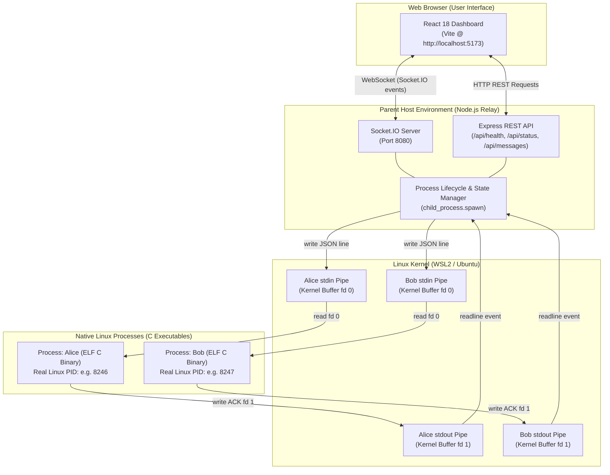

# IPC Chat — Inter-Process Communication in Real Time

> **Operating Systems Hackathon Project**  
> Real-time bidirectional Inter-Process Communication (IPC) between independent native Linux C processes via operating-system-managed anonymous pipes, coordinated through an Express/Socket.IO parent relay with a modern, responsive React dashboard.

---

## Table of Contents
1. [Project Overview](#1-project-overview)
2. [Problem Statement & Objectives](#2-problem-statement--objectives)
3. [Architecture & Dataflow](#3-architecture--dataflow)
4. [Technologies Used](#4-technologies-used)
5. [Project Structure](#5-project-structure)
6. [Prerequisites & Environment](#6-prerequisites--environment)
7. [Installation & Setup](#7-installation--setup)
8. [Running the Application](#8-running-the-application)
9. [Automated Testing](#9-automated-testing)
10. [REST API Specification](#10-rest-api-specification)
11. [Socket.IO Real-Time Protocol](#11-socketio-real-time-protocol)
12. [Operating Systems Theory & Concepts](#12-operating-systems-theory--concepts)
13. [Hackathon Live Demonstration Guide](#13-hackathon-live-demonstration-guide)
14. [OS Viva Questions & Concise Answers](#14-os-viva-questions--concise-answers)
15. [Troubleshooting](#15-troubleshooting)
16. [Known Limitations & Future Enhancements](#16-known-limitations--future-enhancements)
17. [License](#17-license)

---

## 1. Project Overview

**IPC Chat** provides a live, interactive, and transparent demonstration of operating systems **Inter-Process Communication (IPC)** in action. Instead of simulating communication purely inside JavaScript or database tables, this project executes **real native Linux processes** compiled from C (**Alice** and **Bob**), each assigned its own authentic **Process ID (PID)** by the Linux kernel.

Messages submitted through the browser interface travel over WebSockets (Socket.IO) to a Node.js parent relay process. The backend writes structured data to the standard input (`stdin`) file descriptor of the recipient C worker process through a kernel-managed anonymous pipe (`pipe(2)`). The C worker reads the data, processes it, increments its internal received message counter, and emits a structured delivery acknowledgement (ACK) via standard output (`stdout`). The parent relay matches this acknowledgement against the pending message ID and broadcasts the confirmed delivery to connected clients in real time.

> [!NOTE]
> The Node.js backend serves as an **Operating System Gateway and Relay**. Because web browsers cannot invoke Linux system calls directly due to sandbox isolation, Node.js bridges WebSocket web protocols with OS anonymous pipes. Alice and Bob run as genuine independent OS processes.

---

## 2. Problem Statement & Objectives

### The Problem
In modern software engineering, developers often interact solely with high-level application protocols (HTTP, WebSockets, gRPC, cloud message brokers) without understanding the core operating system primitives that enable multi-process computing on a single host. Academic demonstrations of IPC are traditionally confined to dry terminal utilities (`pipe()`, `fork()`, `grep | wc -l`), making it difficult to visualize real-time process lifecycle events, backpressure, buffer flushing, and kernel pipes.

### Project Objectives
1. **Real Operating System IPC:** Demonstrate genuine Linux child process creation and anonymous pipe communication (`stdin`/`stdout`).
2. **Transparent Process Introspection:** Expose actual Linux kernel PIDs, process lifecycles, and delivery acknowledgements directly to the web UI.
3. **Robust Fault Tolerance:** Support process failure detection, graceful recovery, and on-demand process restarts with live PID reassignment.
4. **Interactive & Educational:** Provide a visual pipeline diagram and OS viva reference material directly in the dashboard.
5. **Zero Cloud Dependencies:** Run completely offline on local Ubuntu / WSL2 without external databases or third-party cloud services.

---

## 3. Architecture & Dataflow



### Complete End-to-End Message Flow
1. **User Interaction:** The user chooses **Alice** as sender, enters a message for **Bob**, and clicks **Send** (or presses `Enter`).
2. **Client Dispatch:** The React frontend assigns a unique message ID (`msg-...`) and sends a `chat:send` event through Socket.IO.
3. **Backend Validation:** Node.js verifies that `from` and `to` are valid ("Alice" or "Bob"), `from !== to`, message length is between 1 and 2000 characters, and the recipient process is currently online.
4. **Optimistic UI Update:** React displays the bubble in a `sending` state.
5. **Kernel Pipe Transmission:** Node.js serializes the payload into a JSON Line and writes it directly to Bob's child process `stdin` file descriptor:
   ```json
   {"id":"msg-1729158300","from":"Alice","to":"Bob","text":"Hello Bob!","timestamp":"2026-10-17T04:30:00.000Z"}\n
   ```
6. **Kernel Buffering:** The Linux kernel buffers the bytes inside the anonymous pipe circular buffer (`pipe(2)`).
7. **C Process Ingestion:** Bob's C worker unblocks from `fgets()`, safely parses the JSON fields, verifies that the message was addressed to Bob, increments its internal received message counter, and logs diagnostic information to `stderr`.
8. **Structured Acknowledgement:** Bob's C worker generates a structured JSON ACK on `stdout` (`fd 1`) and flushes immediately:
   ```json
   {"type":"ack","id":"msg-1729158300","sender":"Alice","recipient":"Bob","recipientPid":8247,"status":"delivered","processedCount":1,"receivedAt":1729158300}\n
   ```
9. **Parent Coordination:** The Node.js backend receives the line via `readline`, matches the `id` against its map of pending requests, clears the timeout timer, stores the message in the current session history, and emits `chat:delivery`.
10. **Delivery Confirmation:** The React frontend updates the bubble status to `Delivered (Pipe Ack)` and displays the real PID of the receiving C process (`Ack by PID 8247`).

---

## 4. Technologies Used

- **Operating System:** Ubuntu Linux on WSL2 (Kernel 6.18 x86_64)
- **C Compiler:** GCC 15 (`-Wall -Wextra -Wpedantic -std=c11 -O2`)
- **Backend Runtime:** Node.js v22 & Express 5
- **Real-Time Layer:** Socket.IO v4 (WebSocket with HTTP polling fallback)
- **Frontend Framework:** React 18 & Vite 6
- **IPC Mechanism:** OS Anonymous Pipes (`pipe()`, `stdin` fd 0, `stdout` fd 1)
- **Data Protocol:** JSON Lines (NDJSON)

---

## 5. Project Structure

```text
os_hackathon/
├── Makefile                       # Central task runner (install, build, start, stop, test)
├── package.json                   # Root package metadata & npm scripts
├── README.md                      # Comprehensive documentation & OS viva guide
├── Inter-Process Chat Application Using IPC.pptx # Hackathon presentation slide deck
├── backend/
│   ├── package.json               # Backend dependencies (express, cors, socket.io)
│   ├── package-lock.json
│   └── server.js                  # Process manager, pipe orchestrator & REST API
├── frontend/
│   ├── package.json               # Frontend dependencies (react, vite, socket.io-client)
│   ├── index.html                 # HTML5 document entrypoint
│   ├── vite.config.js             # Vite configuration with API/WS proxies
│   └── src/
│       ├── main.jsx               # React 18 root mounting
│       ├── App.jsx                # Application state & Socket.IO listener
│       ├── style.css              # Dark OS terminal aesthetic stylesheet
│       └── components/
│           ├── Navbar.jsx         # Connection status & Ubuntu WSL2 badges
│           ├── ProcessCard.jsx    # Live Linux PIDs, uptimes & restart triggers
│           ├── ChatWindow.jsx     # Directional chat interface with auto-scroll
│           ├── MessageBubble.jsx  # Directional bubble with PID ACK confirmation
│           ├── SystemMonitor.jsx  # Interactive IPC architecture visualizer
│           └── ActivityLog.jsx    # Real-time backend system audit log
├── ipc/
│   ├── chat_worker.c              # Native C worker program (JSON Lines protocol)
│   └── chat_worker                # Compiled ELF 64-bit Linux executable
├── scripts/
│   ├── start.sh                   # Automated prerequisite check & launcher
│   └── stop.sh                    # Graceful process cleanup script
├── logs/                          # Runtime logs for backend and frontend
└── tests/
    ├── ipc_worker_test.sh         # Automated unit test suite for C binary
    └── api_test.sh                # End-to-end integration test suite
```

---

## 6. Prerequisites & Environment

To run this application locally, ensure you have:
- **Ubuntu on WSL2** (or native Linux distribution)
- **GCC compiler** (`sudo apt update && sudo apt install build-essential`)
- **Node.js** (v18+ or v22) & **npm** (`sudo apt install nodejs npm`)
- **System utilities** (`sudo apt install curl psmisc lsof`)

---

## 7. Installation & Setup

Navigate to the project root inside Ubuntu:

```bash
cd /mnt/d/os_hackathon
```

### 1. Install Dependencies
Installs required npm dependencies for both backend and frontend:

```bash
make install
```

### 2. Build Binaries & Assets
Compiles the C worker with strict GCC flags and builds the production frontend:

```bash
make build
```

This compiles `ipc/chat_worker.c` with:
```bash
gcc -Wall -Wextra -Wpedantic -std=c11 -O2 ipc/chat_worker.c -o ipc/chat_worker
```

---

## 8. Running the Application

### Single-Command Start
Run the make target or execute the startup script directly:

```bash
make start
# Or directly: bash scripts/start.sh
```

> [!TIP]
> From Windows PowerShell, you can launch the application directly through WSL:
> ```powershell
> wsl -d Ubuntu bash -c "cd /mnt/d/os_hackathon && make start"
> ```

The automated startup script:
1. Validates that `gcc`, `node`, and `npm` are installed.
2. Checks that ports `8080` and `5173` are free (cleans stale sockets if present).
3. Compiles `ipc/chat_worker.c` with optimization and strict warnings.
4. Starts the backend relay and waits for the readiness health check (`/api/health`).
5. Spawns genuine Linux C processes for **Alice** and **Bob**, capturing their real PIDs.
6. Launches the Vite development server on port `5173`.
7. Displays a live dashboard banner with all service URLs.

### URLs
- **Frontend Dashboard:** [http://localhost:5173](http://localhost:5173)
- **Backend Health Check:** [http://localhost:8080/api/health](http://localhost:8080/api/health)
- **Backend Status API:** [http://localhost:8080/api/status](http://localhost:8080/api/status)
- **Messages History:** [http://localhost:8080/api/messages](http://localhost:8080/api/messages)

### Stopping the Application
Press `Ctrl+C` in the terminal where `make start` is running, or execute from another terminal:

```bash
make stop
# Or directly: bash scripts/stop.sh
```

---

## 9. Automated Testing

Run the full automated test suite using:

```bash
make test
```

### Suite 1: C Worker Unit Tests (`tests/ipc_worker_test.sh`)
- **Test 1:** Compiles `chat_worker.c` with `-Wall -Wextra -Wpedantic -std=c11 -O2` (0 warnings).
- **Test 2:** Verifies worker startup and real Linux PID extraction from `stderr`.
- **Test 3:** Tests ping/pong diagnostic probe over `stdin`/`stdout`.
- **Test 4:** Tests valid message ingestion and structured JSON ACK emission.
- **Test 5:** Verifies sequential message delivery and internal processed counter increments.
- **Test 6:** Tests safe error handling on malformed JSON (worker returns error JSON and stays alive).
- **Test 7:** Tests clean EOF handling (worker exits with exit code 0 when pipe closes).

### Suite 2: Backend & Integration Tests (`tests/api_test.sh`)
- **Test 1:** `GET /api/health` responsiveness.
- **Test 2:** `GET /api/status` returns positive integer PIDs for both Alice and Bob.
- **Test 3:** Validation rejects unauthorized senders/recipients (HTTP 400).
- **Test 4:** Validation rejects empty or whitespace-only messages (HTTP 400).
- **Test 5:** Alice ➔ Bob delivery via pipe, acknowledged by Bob's real C PID.
- **Test 6:** Bob ➔ Alice delivery via pipe, acknowledged by Alice's real C PID.
- **Test 7:** `GET /api/messages` preserves session message history.
- **Test 8:** `POST /api/processes/Alice/restart` cleanly kills old worker and spawns a replacement worker with a new PID.
- **Test 9:** Message delivery to restarted worker succeeds with new PID.
- **Test 10:** `GET` and `DELETE /api/activity` system audit log functionality.

---

## 10. REST API Specification

| Endpoint | Method | Description | Sample Response |
| :--- | :--- | :--- | :--- |
| `/api/health` | `GET` | Service readiness probe | `{"status":"ok","uptime":42,"os":"Linux..."}` |
| `/api/status` | `GET` | Detailed process metadata & PIDs | `{"status":"online","workers":{"Alice":{"pid":8246,"online":true,...}}}` |
| `/api/messages` | `GET` | Current session message history | `{"messages":[...],"count":12}` |
| `/api/messages` | `POST` | Dispatch message via OS pipe | `{"from":"Alice","to":"Bob","text":"Hi"}` |
| `/api/processes/:name/restart` | `POST` | Safely restart a C worker | `{"success":true,"process":{"name":"Alice","pid":8310}}` |
| `/api/activity` | `GET` | Recent system activity events | `{"activities":[...],"count":24}` |
| `/api/activity` | `DELETE` | Clear in-memory activity logs | `{"success":true,"message":"Activity log cleared"}` |

---

## 11. Socket.IO Real-Time Protocol

### Client-to-Server Events
- `chat:send` — Emits `{ id?, from, to, text }`.
- `process:restart` — Emits `{ processName }` to restart Alice or Bob.
- `activity:clear` — Emits `{}` to clear activity logs.

### Server-to-Client Events
- `chat:connected` — Initial handshake payload (server time, active workers, history, logs).
- `chat:message` — Broadcasts message in `sending` state.
- `chat:delivery` — Broadcasts confirmed delivery once C worker emits ACK from `stdout`.
- `chat:error` — Broadcasts validation failure or delivery timeout error.
- `process:status` — Broadcasts updated worker PIDs, statuses, and uptimes.
- `activity:event` — Streams live audit log entries with severity (`info`, `success`, `warn`, `error`).
- `activity:clear` — Notifies clients that activity history was cleared.

---

## 12. Operating Systems Theory & Concepts

### What is Inter-Process Communication (IPC)?
In modern operating systems, each process executes within its own private **virtual address space** created and protected by the Memory Management Unit (MMU). One process cannot directly read or write the memory of another process. **Inter-Process Communication (IPC)** refers to kernel-provided mechanisms that allow independent processes to safely exchange data and synchronize execution.

### What is an Operating System Process & PID?
A process is a program in execution. It encompasses executable machine code, program counter, CPU registers, stack, heap, and a table of open file descriptors. The **Process ID (PID)** is a unique positive integer assigned by the kernel to identify each active process.

### What is an Anonymous Pipe?
An anonymous pipe is a unidirectional data channel managed in kernel memory (via a circular buffer, typically 64 KB in Linux). Created via the `pipe(2)` system call, it provides two file descriptors:
- `fd[0]`: Open for reading.
- `fd[1]`: Open for writing.

Data written to `fd[1]` is buffered by the kernel and read in First-In, First-Out (FIFO) order from `fd[0]`. When the buffer is empty, a reading process blocks until data is available.

### How Stdin and Stdout Act as IPC Channels
By standard convention in Unix-like systems:
- File descriptor `0` is `stdin` (standard input).
- File descriptor `1` is `stdout` (standard output).
- File descriptor `2` is `stderr` (standard diagnostics).

When Node.js spawns `chat_worker` via `child_process.spawn()`, the parent process creates two pipe pairs:
1. Parent writes to Child's `stdin` (`pipe[1]` $\rightarrow$ Child `0`).
2. Child writes to Parent's `stdout` (`pipe[0]` $\leftarrow$ Child `1`).

The C program simply reads from `stdin` using standard library functions like `fgets()`, oblivious to whether the input originates from a terminal keyboard or another process.

### Why is Node.js Needed in This Architecture?
Web browsers run inside a sandboxed JavaScript runtime with strict security boundaries. Web browsers **cannot make Linux system calls** like `pipe()`, `fork()`, or `read()` on arbitrary OS file descriptors. Node.js acts as an **Operating System Gateway**: it interfaces with the browser via WebSockets (Socket.IO) and interfaces with the Linux kernel via system calls.

### How the C Worker and Frontend Work Together
1. The frontend maintains reactive UI state for process status and message history.
2. The user initiates an action in the frontend.
3. The Node.js backend acts as an intermediary, translating web events into OS pipe writes.
4. The C worker performs the actual message processing in native Linux user-space, outputting an ACK.
5. The backend parses the ACK and confirms delivery to the frontend, ensuring the user only sees "Delivered" when the C process actually processed the message.

---

## 13. Hackathon Live Demonstration Guide

Use this script during your hackathon presentation or viva demonstration:

1. **Start the Stack:**
   ```bash
   make start
   ```
   Show the startup terminal output highlighting strict GCC compilation and the genuine Linux PIDs assigned to Alice and Bob.

2. **Open the Dashboard:**
   Navigate to [http://localhost:5173](http://localhost:5173).
   - Point out the **Socket.IO Connected** pill.
   - Point out the **Ubuntu WSL2 Linux** and **OS Pipes** badges.

3. **Verify Genuine Linux Processes:**
   - Note the PIDs displayed on Alice's and Bob's cards.
   - Open a secondary Ubuntu terminal and run:
     ```bash
     ps aux | grep chat_worker
     ```
     Demonstrate to the judges that the PIDs in `ps aux` match the exact numbers on the dashboard.

4. **Send Alice ➔ Bob Message:**
   - Select "Send as Alice".
   - Type `"Hello Bob! IPC message across kernel pipes."` and hit Enter.
   - Watch the bubble transition from `Sending...` to `Delivered (Pipe Ack)` with Bob's PID badge.
   - Show Bob's **Messages Processed** counter increment.
   - Show the **Real-Time OS Activity Log** recording the `MESSAGE_SUBMIT` and `MESSAGE_ACK` events with millisecond timestamps.

5. **Send Bob ➔ Alice Message:**
   - Switch to "Send as Bob".
   - Type `"Acknowledged Alice! Returning data across fd 1."` and hit Enter.
   - Verify bidirectional communication.

6. **Demonstrate Process Fault Recovery:**
   - Click the **Restart Alice Process** button on Alice's card.
   - Observe that the Linux kernel terminates the old process and assigns a **brand-new PID** to Alice.
   - Send another message from Bob to Alice to prove that communication immediately resumes with the new process.

7. **Presentation Slide Deck:**
   The repository includes a ready-to-present PowerPoint slide deck:
   [`Inter-Process Chat Application Using IPC.pptx`](file:///d:/os_hackathon/Inter-Process%20Chat%20Application%20Using%20IPC.pptx).

---

## 14. OS Viva Questions & Concise Answers

### Q1: What is IPC and why is it necessary?
**Answer:** Inter-Process Communication (IPC) is a set of OS mechanisms that allow distinct processes to share data and synchronize state. It is necessary because modern operating systems enforce strict **memory isolation** between processes through virtual memory; without IPC, independent processes cannot cooperate.

### Q2: What is an anonymous pipe, and how does it work?
**Answer:** An anonymous pipe is a unidirectional byte stream managed by the operating system kernel inside a circular buffer in kernel memory. It is created using the `pipe(2)` system call, returning two file descriptors. It has no name in the file system and typically connects parent and child processes.

### Q3: How do `stdin` and `stdout` act as IPC pipes?
**Answer:** In Unix, file descriptor 0 is standard input and file descriptor 1 is standard output. A parent process can duplicate pipe file descriptors onto the child's descriptors 0 and 1 using `dup2()`. The child then reads and writes to the pipe using regular I/O calls (`fgets`, `printf`), enabling transparent IPC.

### Q4: What is the role of `fork()` and `exec()` in process creation?
**Answer:** `fork()` creates an exact duplicate of the calling process, copying the page tables and duplicating open file descriptors. `exec()` (or `execve()`) replaces the current process image with a new executable program from disk, preserving open file descriptors that do not have `FD_CLOEXEC` set.

### Q5: Is this implementation using `fork()` directly in C?
**Answer:** No. In this architecture, the Node.js backend acts as the parent coordinator, invoking `child_process.spawn()`. Under the hood on Linux, Node.js calls `pipe(2)` to create the channels, `clone()` or `fork()` to create the child process, `dup2()` to map the pipes to `stdin`/`stdout`, and `execve()` to execute `./ipc/chat_worker`. The C worker itself is an independent binary.

### Q6: What is the difference between pipes and shared memory?
**Answer:** 
- **Pipes:** Stream-oriented, kernel-buffered, unidirectional, and implicitly synchronized (reads block on an empty pipe; writes block on a full pipe). Every read/write requires a context switch and data copy between user space and kernel space.
- **Shared Memory:** Multiple processes map the same physical memory frames into their virtual address spaces. Communication occurs at memory speed without kernel copying, but processes must manage their own synchronization (e.g., using semaphores or mutexes).

### Q7: What is a Process ID (PID) and how is it allocated?
**Answer:** A Process ID is a unique positive integer assigned by the kernel from a PID counter (up to `/proc/sys/kernel/pid_max`, typically 32,768 or 4,194,304). When a process exits and its parent reads its termination status via `waitpid()`, the PID is freed and recycled.

### Q8: What happens if a process writes to a pipe whose reading end has closed?
**Answer:** The operating system kernel raises the `SIGPIPE` signal to the writing process. If the process ignores or handles `SIGPIPE`, the write system call fails and returns `-1` with `errno` set to `EPIPE` (Broken Pipe).

### Q9: Why is `fflush(stdout)` or `setvbuf()` necessary in real-time pipe IPC?
**Answer:** By default in the C standard library, `stdout` is **block-buffered** (usually 4 KB or 8 KB) when connected to a pipe or file, rather than line-buffered like an interactive terminal. Without calling `setvbuf(stdout, NULL, _IOLBF, 0)` or `fflush(stdout)`, messages would remain trapped in user-space C stdio buffers until full, preventing real-time transmission.

### Q10: Why can't a web browser communicate directly with C processes via OS pipes?
**Answer:** For security reasons, the browser runs in a sandbox with restricted privileges. It cannot invoke arbitrary Linux kernel system calls or access the host filesystem's file descriptors. A server runtime (Node.js) is required to bridge web protocols (WebSockets) to operating system primitives (kernel pipes).

### Q11: What is pipe capacity and backpressure in Linux?
**Answer:** In Linux (since kernel 2.6.11), the default capacity of an anonymous pipe is 65,536 bytes (16 pages of 4 KB). If the writer fills the pipe faster than the reader consumes it, subsequent `write()` calls block until the reader drains the buffer. This natural flow control is known as **kernel-level backpressure**.

### Q12: What is the difference between anonymous pipes and named pipes (FIFOs)?
**Answer:** Anonymous pipes have no filesystem name, exist only in memory, and can only connect related processes with a common ancestor. Named pipes (FIFOs created via `mkfifo(3)`) exist as special files on the filesystem directory tree and can connect completely unrelated processes started at different times.

---

## 15. Troubleshooting

| Issue | Cause | Solution |
| :--- | :--- | :--- |
| `Port 8080 or 5173 occupied` | Previous server instance still listening | Run `make stop` or `fuser -k 8080/tcp 5173/tcp`. |
| `Worker binary not found` | C worker has not been compiled | Run `make build` or `gcc -O2 ipc/chat_worker.c -o ipc/chat_worker`. |
| `Curl fails with Connection Refused` | Server still booting on WSL DrvFS | Allow 5–8 seconds for initial module loading; test with `curl http://127.0.0.1:8080/api/health`. |
| `Process offline in UI` | C worker crashed or was killed | Click **Restart Process** button on the process card. |
| `Browser shows Disconnected` | Backend is stopped or firewall blocked | Ensure backend is running via `make start` and check `logs/backend.log`. |

---

## 16. Known Limitations & Future Enhancements

### Known Limitations
1. **Relayed Architecture:** Alice and Bob do not have a direct peer-to-peer pipe between them; the Node.js parent process acts as an intermediary relay to coordinate with the browser UI.
2. **Session Memory:** Message history is preserved in volatile memory during the current server lifecycle; persistent disk storage (e.g., SQLite) is omitted to keep the project self-contained and zero-dependency.
3. **Local Loopback:** Designed primarily for local single-host operation under Linux/WSL2; remote network clients require appropriate host firewall configuration.

### Future Enhancements
1. **Direct Named Pipe (FIFO) Pairing:** Implement named pipes via `mkfifo()` allowing Alice and Bob to also write directly to each other's dedicated FIFOs without parent process arbitration.
2. **Shared Memory & POSIX Semaphores:** Add a comparative IPC tab demonstrating POSIX shared memory (`shm_open`, `mmap`) with semaphores (`sem_open`) alongside pipes.
3. **Simulated Network Latency / Packet Drops:** Add artificial kernel-level delay controls to demonstrate buffer saturation and backpressure under load.

---

## 17. License

This project is open-source and developed for the Operating Systems Hackathon under the **MIT License**.
